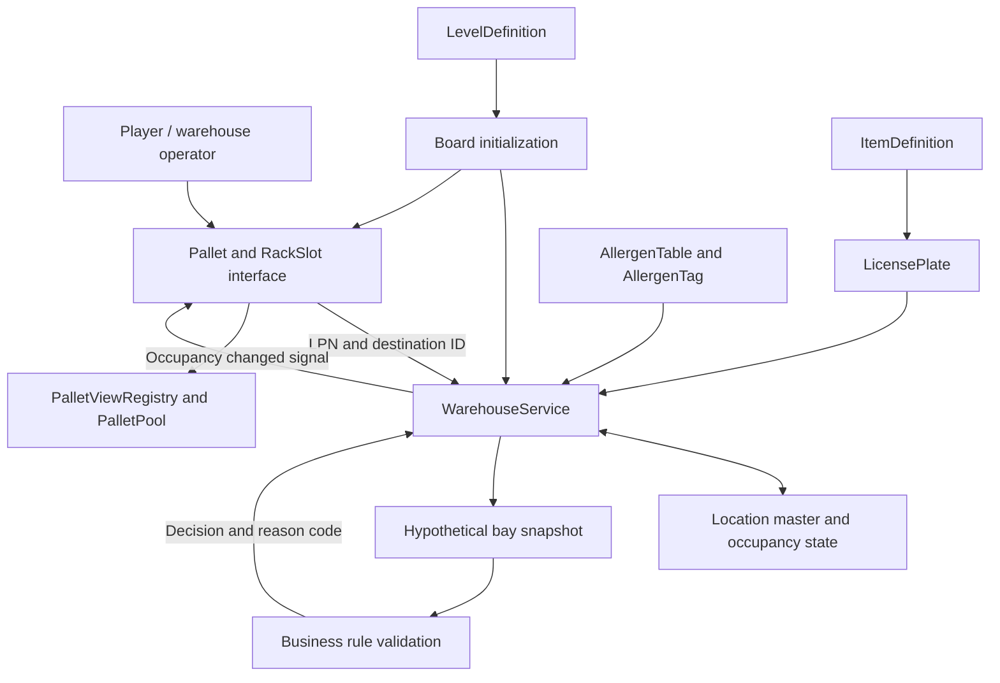
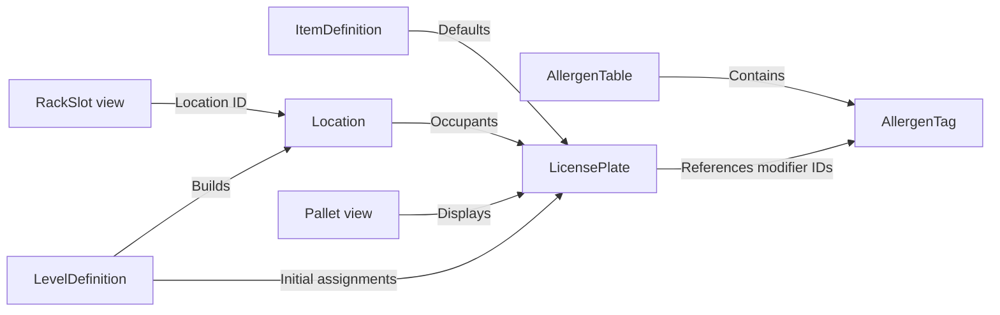
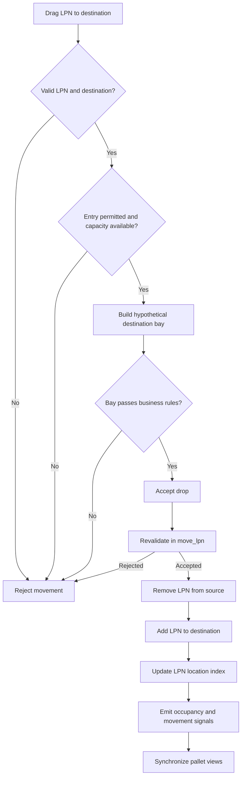

# Allergen Control Game

**A warehouse allergen-control simulation and WMS-style business rules engine built with Godot 4.4 and GDScript.**

Allergen Control Game is a personal software development project inspired by my experience in inventory control and receiving at a food manufacturing facility. It uses a drag-and-drop puzzle game to model an operational problem: how to store incoming inventory efficiently while preventing incompatible materials from being stored above or below one another.

I designed the project with two objectives: to learn application development in Godot and to explore how warehouse storage policies could be translated into automated inventory transaction controls. Rather than embedding those policies directly in the game interface, I modeled the underlying system after a warehouse management system (WMS), separating item master data, inventory identity, location master data, transaction processing, business rules, and presentation.

The current implementation is a proof of concept for rule-based pallet movement. The longer-term objective is a browser-based puzzle game that also demonstrates the potential for automated allergen exception detection and directed putaway.

## Problem and requirements

In a food manufacturing warehouse, a storage location can be physically available without being appropriate for a particular material. An ingredient stored above another ingredient may create a cross-contamination risk; specialty materials may require protection from conventional ingredients; and packaging may require protection from ingredients altogether.

The decision depends on the attributes of both the moving inventory and the other inventory in the same vertical storage bay. Checking only the destination slot, or only the item immediately above or below it, is insufficient under the rules modeled in this project.

I translated this problem into the following functional requirements:

- Maintain item-level default attributes separately from the attributes of individual inventory units (license plates, or LPNs).
- Represent warehouse locations using logical identifiers, bay membership, vertical level, capacity, and occupancy.
- Evaluate a proposed inventory movement before committing it to warehouse state.
- Reject movements into unknown, blocked, full, or allergen-incompatible destinations under the default configuration.
- Evaluate the entire destination bay, including nonadjacent pallets separated by empty locations.
- Apply consistent rules independently of the user interface or the origin of a movement request.
- Maintain a single authoritative record of an LPN's location and notify the interface when inventory moves.
- Return structured validation results to support diagnostics and future exception reporting.
- Allow the player to reorganize a warehouse with existing violations, rather than requiring the entire warehouse to be compliant before any corrective movement can occur.

The game design adds further requirements: limited storage space, incoming pallets awaiting putaway, increasingly complex layouts, move efficiency, and solvable levels. These provide a controlled environment for exploring the same constraints that make warehouse placement decisions difficult in practice.

## Results and development status

| Capability | Current status |
| --- | --- |
| Warehouse and inventory data model | Implemented with reusable Godot Resources. |
| Configurable rack layout | Implemented through `LevelDefinition` and dynamic scene construction. |
| Interactive inventory movement | Drag-and-drop movement between rack locations implemented. |
| Preventive transaction controls | Centralized destination capacity, entry restriction, and allergen checks implemented. |
| Allergen and specialty validation | Three rule families implemented using hypothetical bay snapshots. |
| UI synchronization | Implemented through warehouse occupancy signals and a registry of pallet views. |
| Level initialization | Implemented in the board; a separate `LevelLoader` prototype exists, but integration with the supplied board is incomplete. |
| Receiving, scoring, procedural levels, and automated putaway | Planned extensions; not part of the supplied implementation. |

The project demonstrates the feasibility of representing warehouse storage policies as deterministic application logic. Development has focused on the core data model, transaction boundary, and rule evaluation rather than completing the game loop.

This is a development prototype, not a deployed WMS extension. Production accuracy, execution performance, time savings, and reductions in food safety incidents have not been formally measured.

## System architecture

The architecture treats the player as a warehouse operator, the game interface as a transaction entry screen, and `WarehouseService` as the authoritative inventory service. The user interface submits requests and displays their results; it does not independently decide whether inventory can move.



### Technology stack

| Technology | Responsibility |
| --- | --- |
| Godot 4.4 | Application framework, 2D interface, scene composition, and drag-and-drop interaction |
| GDScript | Data models, inventory transactions, validation algorithms, and event handling |
| Godot Resources (`.gd` / `.tres`) | Reusable item, inventory, location, allergen, and level definitions |
| Autoload singleton | Shared warehouse state and centralized transaction interface |
| Godot signals | Event-driven synchronization between warehouse state and visual components |

## WMS-inspired data model

The data model distinguishes the material being stored, the specific inventory unit being moved, the location in which it is stored, and the visual representation of that unit.

| Entity | Responsibility | Warehouse equivalent |
| --- | --- | --- |
| `ItemDefinition` | Part number, description, icon, default allergen modifiers, and packaging classification | Item master |
| `LicensePlate` | Pallet identifier, reference to an item, and inventory-specific attributes | LPN / individually tracked inventory unit |
| `Location` | Location identifier, bay, vertical level, capacity, entry restriction, and occupants | Location master and inventory by location |
| `AllergenTag` | Modifier identifier, display name, and rule behavior | Controlled classification / business rule attribute |
| `AllergenTable` | Collection of recognized modifier definitions | Attribute reference data |
| `LevelDefinition` | Rack dimensions, slot capacity, and initial LPN-to-location assignments | Test scenario configuration |
| `Pallet` | Visual representation of a `LicensePlate` | Inventory record displayed in an application |
| `RackSlot` | Visual representation of a warehouse location | Location displayed in an application |



### Separate item master data from inventory-specific attributes

An item master describes the normal properties of a material. A specific pallet may acquire additional handling requirements during its lifecycle. For example, a returned ingredient could require an additional allergen classification after exposure on a production line, without changing the master record for every other pallet of that ingredient.

`LicensePlate` copies the item's default modifiers into a separate list, allowing inventory-specific changes. This is intended to support future workflows involving returned inventory and contamination-related exceptions.

Packaging classification is currently derived from the first three digits of the item part number: family codes 200–299 are treated as packaging. This is a project-specific classification convention rather than a universal ERP standard.

### Separate warehouse topology from the display

A warehouse location is represented by a logical ID, a bay ID, and an ordered vertical level. The service discovers the locations in a bay and sorts them by level before evaluating storage relationships. It does not need to traverse visual scene nodes or infer contamination relationships from screen coordinates.

The supplied `LevelDefinition` generates identifiers such as `01-01` and `01-02`, with level 1 at the top of the displayed bay. Rack dimensions are configurable; the default is three bays by four levels.

## Business rules engine

The prototype models a simplified set of vertical storage rules inspired by food manufacturing warehouse procedures. These are scenario-specific business rules, not a comprehensive statement of food safety regulations or approved storage practices.

The design defines seven conventional allergen modifiers (peanut, tree nut, egg, dairy, soy, gluten, and wheat), two specialty modifiers (organic and non-GMO), and a separate packaging classification. The actual recognized tag IDs are configured through `AllergenTable` resources.

| Rule family | Business rule | Example of a rejected arrangement |
| --- | --- | --- |
| `DRIP_DOWN` | Every ingredient below an allergen-containing ingredient must contain all applicable drip-down modifiers present above it. | Peanut-containing material above material without peanut. |
| `PURITY_UP` | An ingredient with a specialty modifier cannot be stored below an ingredient lacking that modifier. | Organic material below conventional material. |
| Packaging restriction | Packaging cannot be stored below an ingredient. Packaging above ingredients is permitted by the modeled rule. | Cartons stored below a sack of flour. |

Each conventional allergen is evaluated independently. A lower ingredient that contains both peanut and dairy can satisfy the modeled drip-down requirements of an ingredient containing only peanut above it. The reverse arrangement would fail because the lower ingredient lacks dairy. Specialty attributes follow the opposite directional constraint.

Empty locations do not interrupt the vertical relationship. Packaging is handled separately from ingredient-to-ingredient modifier checks.

### Illustrative storage scenarios

Assume each column represents a separate bay, and that no other modifiers apply:

| Vertical level | Valid bay | Allergen violation | Specialty violation | Packaging violation |
| --- | --- | --- | --- | --- |
| Top | Packaging | Peanut | Conventional | Conventional |
| Middle | Conventional | Empty | Empty | Empty |
| Bottom | Peanut | Conventional | Organic | Packaging |

### Validate a proposed state, not just a destination slot

`WarehouseService.build_bay_snapshot()` creates an ordered, top-to-bottom representation of a bay. Each occupied position contains the inventory unit, its effective modifiers, and its packaging status. Empty positions are represented by `null`.

When evaluating a movement, the function constructs the hypothetical post-move state: it removes the moving LPN from its source position if that position is in the inspected bay, and inserts the LPN at the proposed destination. This enables the same validator to inspect an existing bay or assess a proposed movement without first altering inventory occupancy.

`validate_bay_snapshot()` evaluates the resulting state in three passes:

1. **Packaging:** track whether any ingredient has appeared above the current position; reject packaging encountered beneath an ingredient.
2. **Drip-down:** accumulate the allergen modifiers encountered in ingredients above; require every subsequent ingredient to contain the accumulated modifiers.
3. **Purity-up:** track which specialty modifiers remain permissible below the current position; once an ingredient lacks a modifier, reject that modifier on subsequent ingredients.

Conceptually, drip-down modifier sets must stay the same or grow when moving downward through the ingredients, while specialty modifier sets must stay the same or shrink. Accumulating these constraints across the bay avoids treating each pair of adjacent locations as an isolated decision.

The validator returns a dictionary containing an acceptance flag and a reason code. Rule violations also return the offending position index and, where applicable, modifier ID. For example, a peanut ingredient above a conventional ingredient at the third snapshot position would produce a result equivalent to:

```gdscript
{
    "ok": false,
    "code": AllergenReject.DRIP_DOWN_MISMATCH,
    "tag": "peanut",
    "at_index": 2
}
```

The structured result is suitable for future reporting or operator feedback. In the current movement path, detailed rejection information is printed to the Godot debug console; the public movement result uses a generic `DESTINATION_NOT_ALLOWED` error for failed placement checks.

### Destination-only enforcement

The transaction policy validates the resulting destination bay, rather than requiring the source bay or the entire warehouse to pass validation first. This is a deliberate design choice: a corrective movement should be possible when the source already contains an allergen violation.

The destination bay must be compliant after the proposed movement, including any pre-existing conditions that would remain there. A same-bay movement is evaluated with both the removal and placement reflected in the snapshot. This is a strict preventive control at the destination, not a complete warehouse-wide audit.

## Inventory transaction workflow



The central service exposes several operations:

| Operation | Purpose |
| --- | --- |
| `register_location()` / `register_locations()` | Establish location master records. |
| `get_location_id_for_lpn()` | Resolve an inventory unit's current location. |
| `get_occupants()` | Retrieve the inventory assigned to a location. |
| `get_locations_in_bay()` | Retrieve locations in vertical order. |
| `build_bay_snapshot()` | Represent the current or proposed state of a bay. |
| `validate_bay_snapshot()` | Evaluate storage rules without changing occupancy. |
| `can_place_lpn()` | Check destination restrictions and business rules. |
| `move_lpn()` | Revalidate and commit an accepted inventory movement. |

The service maintains a location dictionary and a reverse LPN-to-location index keyed by the inventory Resource's runtime instance identity. Successful movements emit `location_occupancy_changed` and `lpn_moved` signals, with previous and current occupancy information available to subscribers.

This creates a consistent transaction boundary for the game. A future automated putaway process could submit movement requests through the same interface rather than implementing a second, potentially inconsistent set of business rules.

## Key implementation decisions

### Move inventory records rather than visual objects

An early design treated the pallet scene as the object being moved. I shifted the architecture to model the transaction as an LPN changing locations, with the pallet scene reflecting that transaction.

The drag payload contains the `LicensePlate` Resource, not a reference to a visual pallet node. `RackSlot` delegates placement and movement decisions to the warehouse service and listens for occupancy changes. `PalletViewRegistry` maintains a reusable view for each inventory Resource and manages its association with the appropriate rack slot or pallet pool.

This avoids making the interface the source of truth for inventory. The same underlying model can support manual movement, automated requests, or reporting without tying those processes to the drag-and-drop interaction.

### Centralize the storage rules

The validator evolved from a scene-based inspection of pallets above and below a slot into a service-level analysis of a bay snapshot. Moving the logic out of the rack interface made the rules easier to reason about and established a boundary for independent testing.

The modifier table separates tag definitions from their behavior. Adding another modifier that follows an existing rule family does not require writing a new condition for each tag. Introducing a fundamentally different rule family would still require a code change and validation tests.

### Keep scenario initialization separate from warehouse transactions

A WMS should process warehouse data and inventory transactions; it should not generate puzzle levels. The project therefore uses `LevelDefinition` as a separate scenario model.

The supplied `main.gd` still registers locations and seeds initial inventory while constructing the board. A separate `LevelLoader` prototype begins moving that responsibility out of the board. Its `load_level()` method checks the supplied definition, clears warehouse state, registers generated locations, and seeds starting inventory through `WarehouseService.move_lpn()`. The supplied `main.gd` still performs its own initialization and does not call this loader, so the refactor is not yet integrated in the documented board. Both initialization paths currently use validated inventory movements; neither reports rejected starting placements.

The distinction is important for future handwritten levels, procedural generation, and repeatable test scenarios. Each should be able to prepare warehouse state without changing the normal rules for inventory movement.

## Development testing and acceptance criteria

Development has been iterative, progressing from basic drag-and-drop interaction and slot exclusivity to the data model, centralized warehouse state, hypothetical snapshots, and allergen validation.

One issue investigated during development involved changes to item master modifiers not appearing in existing LPNs because their copied attributes were retained. The supplied initialization code includes a forced refresh from the item master when seeding a level. That addresses stale defaults for simple test fixtures, although a more complete initialization design must preserve intentional inventory-specific overrides.

The following is a representative regression test matrix derived from the requirements and current implementation. It documents expected behavior, not the results of a completed automated test suite.

| Scenario | Expected behavior |
| --- | --- |
| Move conventional inventory to an empty, compliant bay | Accept and update the source and destination occupancy. |
| Move to a full, blocked, or unregistered location | Reject under the default configuration; preserve occupancy. |
| Peanut above conventional inventory with an empty level between them | Reject with `DRIP_DOWN_MISMATCH`. |
| Peanut above inventory containing peanut and dairy | Accept if no other rule is violated. |
| Peanut and dairy above inventory containing only peanut | Reject because dairy is missing below. |
| Conventional inventory above organic inventory | Reject with `PURITY_UP_MISMATCH`. |
| Organic inventory above conventional inventory | Accept if no other rule is violated. |
| Packaging above an ingredient | Accept if no other rule is violated. |
| Packaging below an ingredient | Reject with `PACKAGING_UNDER_INGREDIENT`. |
| Move an LPN out of a noncompliant source into a compliant destination | Accept, subject to destination restrictions. |
| Relocate an LPN within its current bay | Evaluate the simulated removal and insertion together. |
| Reject an incompatible movement | Leave inventory occupancy unchanged and retain the existing pallet view. |

These scenarios can be exercised using constructed bay snapshots for rule-level tests and small rack layouts for integration tests. Additional acceptance criteria are needed for initialization of noncompliant starting states, invalid master data, and multiple occupants per location.

## Source files and scene structure

### Warehouse data and business logic

| File | Purpose |
| --- | --- |
| `warehouse_service.gd` | Location registration, occupancy, reverse location lookup, movement validation, transaction processing, and change notifications |
| `item_definition.gd` | Item master Resource and packaging classification |
| `license_plate_data.gd` | Inventory-specific identity, modifiers, and initialization from item master data |
| `location_definition.gd` | Location master Resource, occupancy, capacity, and entry restriction |
| `allergen_tag.gd` | Modifier definition and behavior enumeration |
| `allergen_table.gd` | Collection and lookup of modifier definitions |
| `level_definition.gd` | Rack configuration, location generation, and starting inventory assignments |
| `level_loader.gd` | Prototype scenario loader that resets warehouse state, registers locations, and seeds starting inventory; not yet integrated with the supplied board |

### Presentation components

| File | Purpose |
| --- | --- |
| `main.gd` | Builds the rack interface and initializes the supplied level configuration |
| `rack_slot.gd` | Displays location occupancy and delegates movement requests to the warehouse service |
| `pallet.gd` | Displays item icons and tooltips and creates LPN-based drag payloads |
| `pallet_view_registry.gd` | Creates, reuses, and parks pallet views independently of warehouse occupancy |

The associated Godot scenes are organized as follows:

```text
main.tscn
└── Main
    ├── Rack (GridContainer)
    ├── PalletViewRegistry
    └── PalletPool (Control)

pallet.tscn
└── Pallet
    └── Icon (TextureRect)

rack_slot.tscn
└── RackSlot
    └── CenterContainer
```

The documented resource set includes `allergen_table.tres`, sample item definitions (`coconut_oil.tres`, `oats.tres`, and `pallet.tres`), three sample license plates, and `test_level.tres`.

## Environment and execution

The project was developed using Godot 4.4 and GDScript. It uses Godot's native scene, Resource, signal, and drag-and-drop systems rather than an external ERP, database, or API.

For a complete Godot project checkout:

1. Open `project.godot` in Godot 4.4.
2. Verify that `WarehouseService` is registered as an autoload using `warehouse_service.gd`.
3. Verify that the allergen table exists at `res://resources/data/allergen_table.tres`, the path referenced by the service.
4. Configure the main scene with a `LevelDefinition`, a rack-slot scene, and a pallet view registry referencing the pallet scene and pool.
5. Run `main.tscn` and drag pallets between locations. Inspect the Godot Output panel for accepted movements and rejected allergen placements.

**Repository status:** This is a development portfolio project. The documented source snapshot consists of GDScript modules and accompanying design information. A script-only checkout will require the associated scenes, `.tres` resources, icons, and `project.godot` configuration before it can be run. A browser export is a planned deliverable rather than a currently documented release.

## Lessons learned and next steps

The most important architectural lesson was that the warehouse problem and the game problem should be treated separately. The warehouse domain requires inventory identity, authoritative state, deterministic rules, and controlled transactions. The game requires scenario design, player interaction, difficulty progression, and scoring. The game becomes a way to exercise and demonstrate the warehouse model, not the reason that the warehouse model exists.

### Core reliability and maintainability

- **Initialization:** finish separating level loading from the board. Provide a distinct fixture-loading path for intentionally noncompliant initial states; the supplied seeding routine uses normal validated movements, which can prevent those scenarios from being reproduced. Validate initial assignment arrays and report rejected seeds.
- **Master data validation:** explicitly reject or flag unrecognized modifier IDs. An `UNKNOWN_TAG` reason code exists, but the supplied validator uses recognized table entries without checking every inventory modifier against the table.
- **Inventory attributes:** distinguish inherited defaults from explicit overrides, including an intentionally empty modifier list, and ensure packaging classification remains synchronized. Avoid overwriting legitimate LPN-specific attributes during level loading.
- **Inventory integrity:** introduce persistent, unique LPN identifiers and protect occupancy records against changes outside the transaction service. Runtime Resource identity is sufficient for a local prototype but not for persistent ERP integration.
- **Location capacity:** the data model supports multiple occupants, but the current bay snapshot and rack view inspect or display only the first. Extend the model and validator before using multi-pallet receiving or storage locations.
- **Testing and diagnostics:** add automated regression tests, more descriptive rejection messages, and a durable movement history. The existing signals and debug messages are useful integration points, not a persistent audit log.

### Game development roadmap

The planned game presents a constrained rack layout and a set of incoming pallets awaiting putaway. Players must resolve storage conflicts and create compatible destinations using available space. A movement cannot return a pallet to receiving, and there is no temporary holding slot, making the order of movements significant.

Future development includes hand-authored levels, a receiving queue, completion criteria, timers and move targets, scoring, and procedural generation of increasingly difficult layouts. A solvability check would be required before generated puzzles could be considered valid. Hand-authored scenarios provide a useful foundation for validating the rules before introducing that additional complexity.

### Potential business automation applications

The same domain model suggests several possible extensions outside the game:

| Application | Proposed workflow |
| --- | --- |
| Allergen exception detection | Import inventory and location data, group inventory by bay, evaluate existing snapshots, and identify incompatible storage arrangements for investigation. |
| Directed putaway | Evaluate candidate storage locations against capacity, entry restrictions, and material compatibility before recommending a destination. |
| Corrective relocation planning | Identify valid sequences of movements that resolve existing violations without creating new ones. |
| Combined reorganization and putaway | Evaluate how to free compatible storage space for incoming inventory while minimizing unnecessary movements. |
| Operator training and process validation | Use controlled scenarios to demonstrate why storage decisions are accepted or rejected and evaluate proposed workflow changes. |

These are prospective applications, not existing integrations or implemented optimization features. A production implementation would require an approved ruleset, verified item and LPN data, integration with an authoritative ERP/WMS, appropriate authorization and audit controls, exception handling, and operational acceptance testing with warehouse and Quality personnel. The prototype should not be used to make actual food safety decisions.

## Relevance to business analysis and process automation

This project demonstrates how I approach translating operational knowledge into system requirements and then into a maintainable technical solution.

| Competency | Application in this project |
| --- | --- |
| Requirements analysis | Converted warehouse storage procedures into functional requirements, rule families, constraints, and expected acceptance criteria. |
| Business process design | Modeled the inventory movement lifecycle, including preventive checks, transaction acceptance, rejection, and corrective movement considerations. |
| ERP/WMS domain modeling | Distinguished item master data, LPN-specific attributes, location master data, and inventory transactions. |
| Business rules and governance | Centralized the decision logic, separated reference data from transaction processing, and identified the need for traceable exceptions and audit controls. |
| Systems architecture | Separated authoritative application state from presentation and defined reusable interfaces for prospective manual and automated processes. |
| Root cause analysis | Investigated inconsistent modifier behavior and identified the distinction between master data changes and previously initialized inventory attributes. |
| Testing and continuous improvement | Designed small, controlled scenarios and identified regression requirements and implementation limitations before expanding scope. |
| Process automation | Established a reusable validation foundation for potential directed putaway, inventory exception detection, and corrective relocation workflows. |

Although the interface is a puzzle game, the underlying problem is an enterprise systems problem: translating operational policies into data structures and enforceable transaction rules while maintaining data integrity, flexibility, and a clear separation of responsibilities. Those principles are applicable to inventory control, manufacturing, master data management, and other ERP-connected business processes beyond food manufacturing.
